# cudallm

## Pedal to the metal with an RTX 3060: chasing the memory limit

A from-scratch C++/CUDA inference engine for **Llama-3.2-1B-Instruct**. No cuBLAS, no cuDNN, no CUTLASS, no PyTorch in the engine: every kernel is hand-written. On a consumer RTX 3060 it decodes at **125 tok/s in bf16, 90% of the card's measured memory-bandwidth limit**.

| **125 tok/s**<br><sub>bf16 decode</sub> | **90%**<br><sub>of memory roofline</sub> | **381 tok/s**<br><sub>int4 decode</sub> | **1.38×**<br><sub>vs HF transformers</sub> | **≥ llama.cpp**<br><sub>at 16- and 8-bit</sub> |
|:-:|:-:|:-:|:-:|:-:|

## Results

Same GPU, same model, 256-token generation (tokens/s, higher is better).

| Weights | **cudallm** | llama.cpp | HF transformers |
|---|:-:|:-:|:-:|
| 16-bit | **124.7** | 123.1 (f16) · 122.9 (bf16) | 90.2 |
| 8-bit  | **231.2** | 215.6 (q8_0) | – |
| 4-bit  | **381.2** | – | – |

<picture>
  <source media="(prefers-color-scheme: dark)" srcset="docs/img/readme/compare-dark.png">
  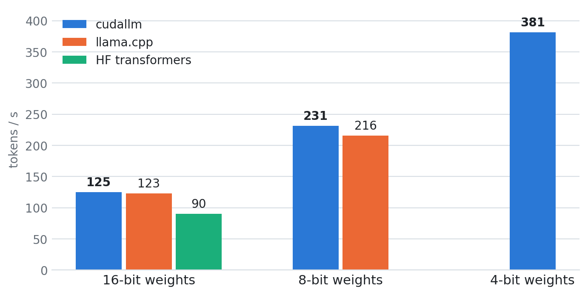
</picture>

<picture>
  <source media="(prefers-color-scheme: dark)" srcset="docs/img/readme/ablation-dark.png">
  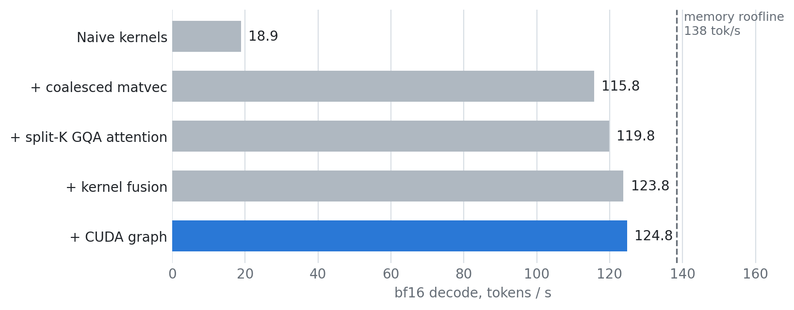
</picture>

<sub>RTX 3060 12 GB. llama.cpp @ fa3645feb, transformers 4.46.3 + torch 2.5.1 (sdpa, no torch.compile). cudallm int8 uses one scale per row while q8_0 uses one per 32 values, so the 8-bit pair is close but not identical.</sub>

## The speed limit

Generating one token at batch size 1 reads **every weight once** (2.47 GB in bf16) and does about one multiply-add per byte. The GPU can compute far faster than that, so the memory bus sets the pace: 342 GB/s measured ÷ 2.47 GB = **138 tok/s ceiling**. Every optimization below is about wasting fewer of those bytes.

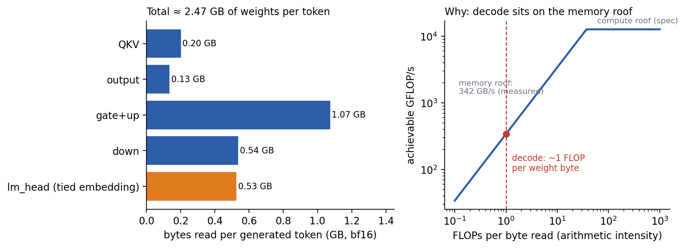

## How it got from 19 to 125 tok/s

| Step | tok/s | % of ceiling |
|---|:-:|:-:|
| Naive kernels | 18.9 | 14% |
| + coalesced matvec | 115.8 | 84% |
| + split-K GQA attention | 119.8 | 87% |
| + kernel fusion | 123.8 | 90% |
| + CUDA graph | **124.8** | **90%** |

**1. Coalesced matrix-vector product (6.1×).** One warp per weight row, 128-bit loads, the input vector staged in shared memory, a persistent grid sized to the GPU.

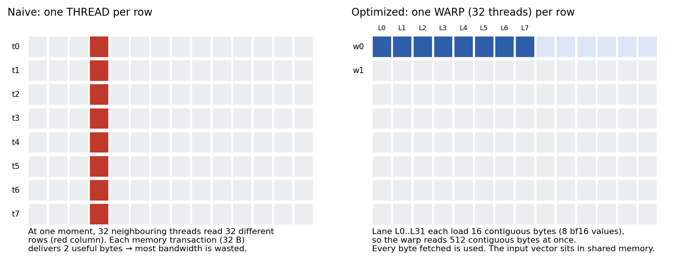

**2. Split-K attention.** One block per (KV head, 128-token chunk); the 4 query heads that share a KV head read its tile once.

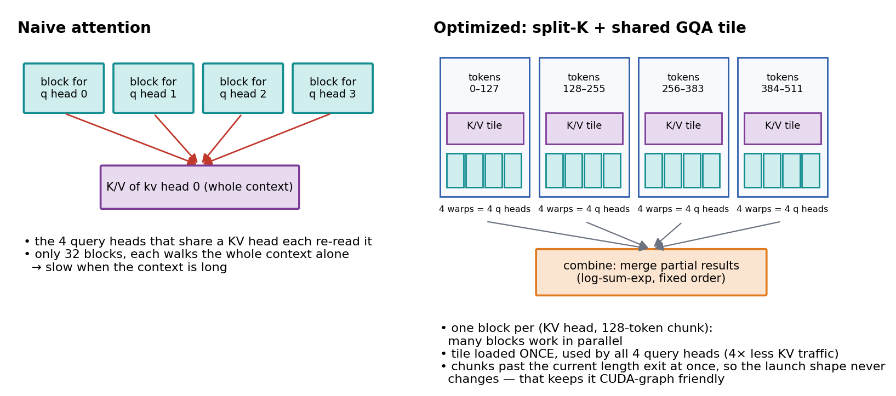

**3. Fusion + CUDA graph.** Norms, residual adds and SwiGLU ride inside the matvecs (181 → 116 kernels per token), and the whole step is replayed as one CUDA graph, shrinking launch gaps from 76 µs to 3 µs per token.

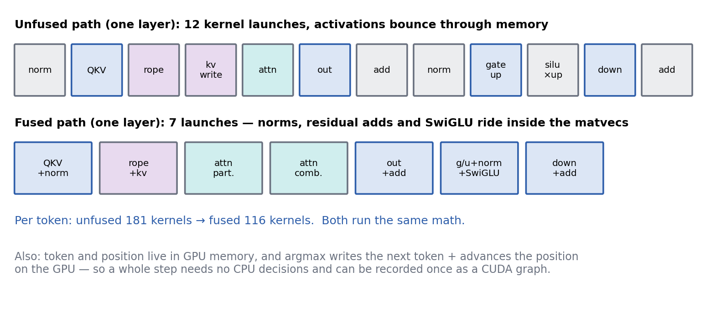

In the end, almost all GPU time is the matvec streaming weights, which is exactly where it should be.

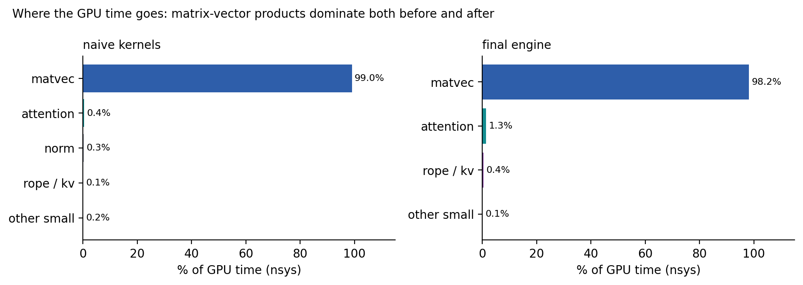

## Long context

Split-K attention keeps speed nearly flat as the KV cache grows; the naive kernel loses almost half its speed by 4,000 tokens.

<picture>
  <source media="(prefers-color-scheme: dark)" srcset="docs/img/readme/context-dark.png">
  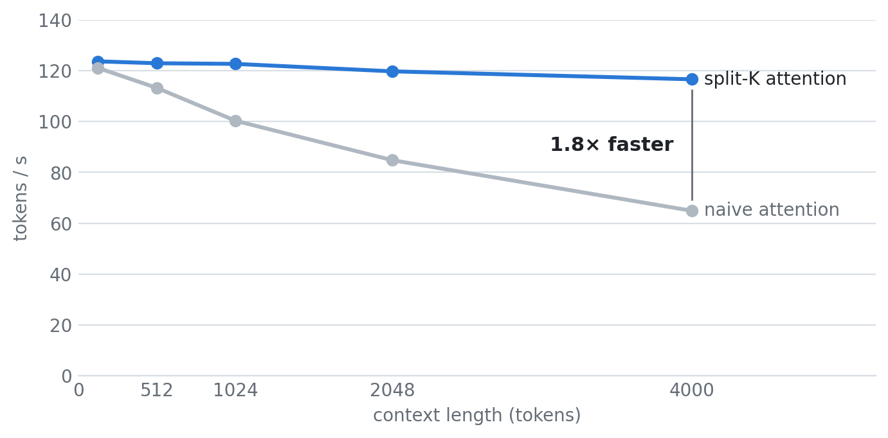
</picture>

## Quantization

int8 nearly doubles speed for a +0.4% perplexity cost. int4 triples it.

<picture>
  <source media="(prefers-color-scheme: dark)" srcset="docs/img/readme/quant-dark.png">
  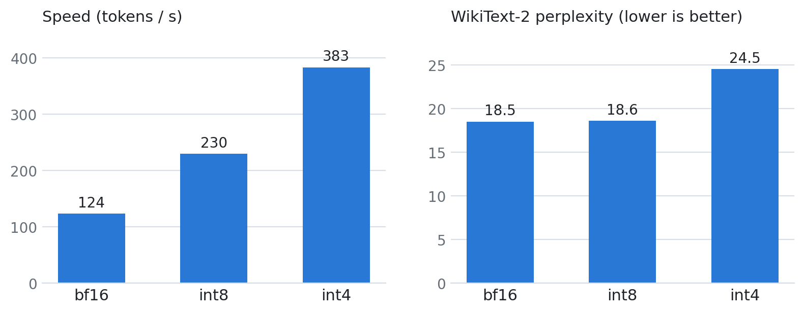
</picture>

The first int4 kernel was *slower* than int8. The culprit: an 8-way shared-memory bank conflict on the staged input. An XOR-swizzled layout spreads the lanes across all banks and more than halved the int4 matvec time.

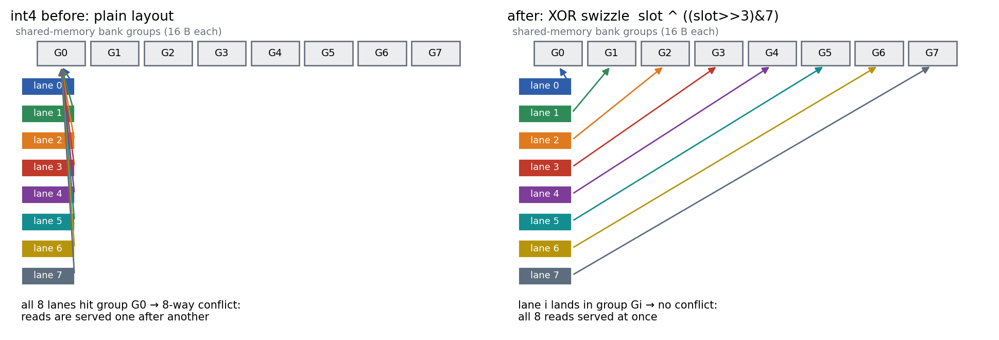

The int4 quality loss comes from plain round-to-nearest quantization itself, not the engine: HF with the same quantized weights scores the same perplexity. Calibration methods like GPTQ/AWQ are the way forward.

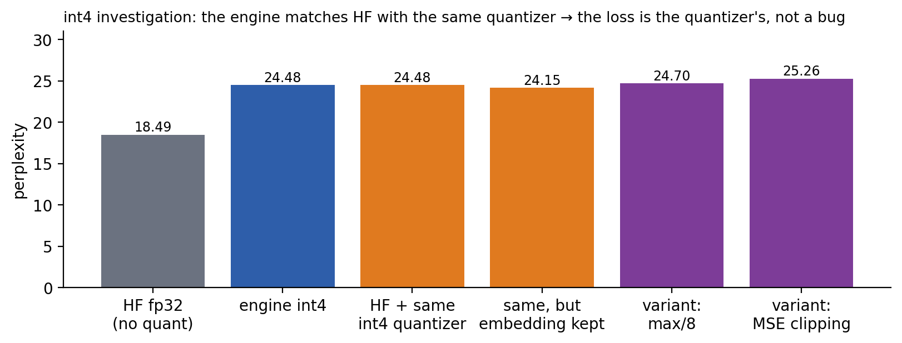

## What didn't help

Ideas are measured, and the ones that don't pay are reverted.

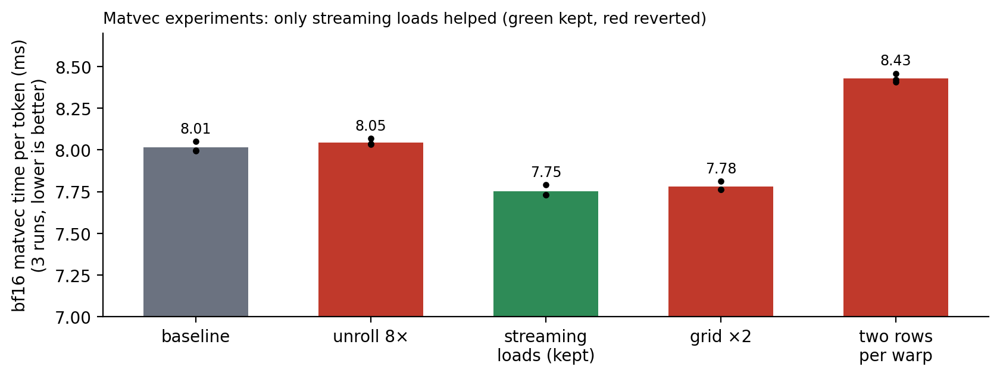

## Correctness

Nothing got faster before it was provably still right.

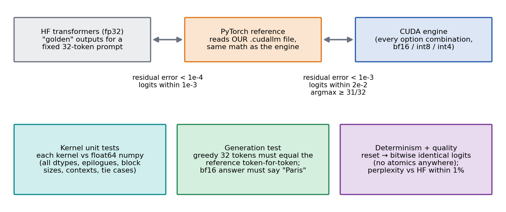

- **226 tests**: every kernel vs float64 numpy, every engine config vs the reference, layer by layer.
- **Deterministic**: no atomics, so CUDA-graph replay gives bit-identical logits.
- **WikiText-2 perplexity**: 18.491 (cudallm bf16) vs 18.494 (HF).

## Architecture

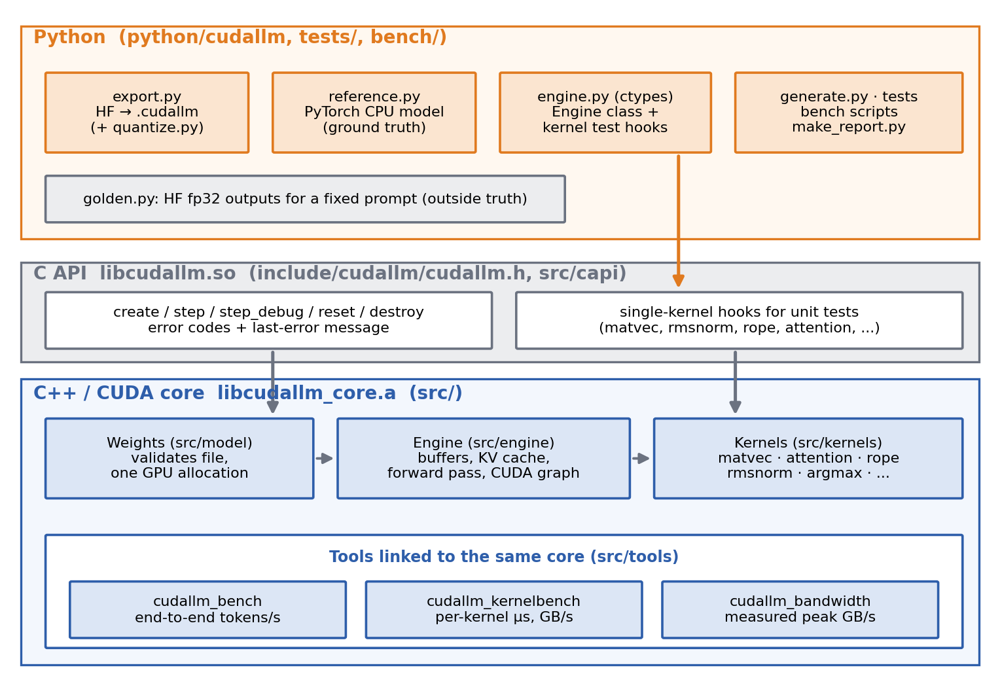

## Quickstart

```bash
bash scripts/setup_env.sh          # gcc-13, CUDA 12.6, Python 3.12 venv (needs sudo)
.venv/bin/huggingface-cli login    # after accepting the Llama 3.2 license on Hugging Face
bash scripts/download_model.sh
bash scripts/build.sh
bash scripts/export_all.sh         # bf16 / int8 / int4 weight files in models/
bash scripts/run_tests.sh
PYTHONPATH=python .venv/bin/python -m cudallm.generate --prompt "What is the capital of France?"
```

Benchmarks: `bench/bench_decode.py --suite all`, then `bench/make_report.py` to rebuild [docs/RESULTS.md](docs/RESULTS.md) (every number on this page).

## Repository

```
src/        engine, CUDA kernels, C API, benchmark binaries
include/    public C header
python/     exporter, quantizer, PyTorch reference, ctypes wrapper
tests/      pytest suite
bench/      benchmarks, perplexity, comparisons, plots
docs/       results and figures
```
