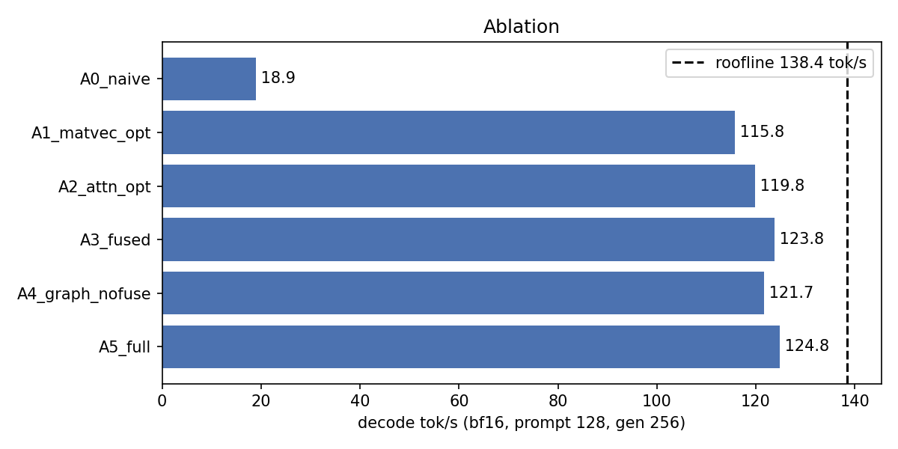
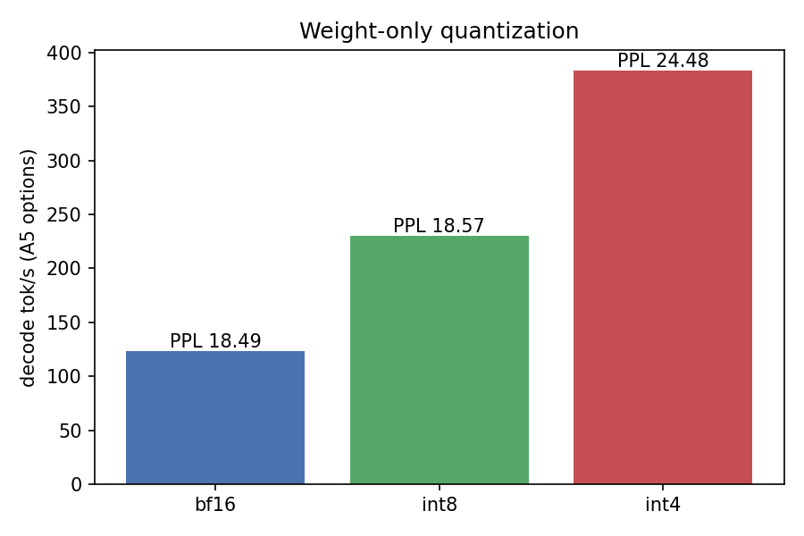
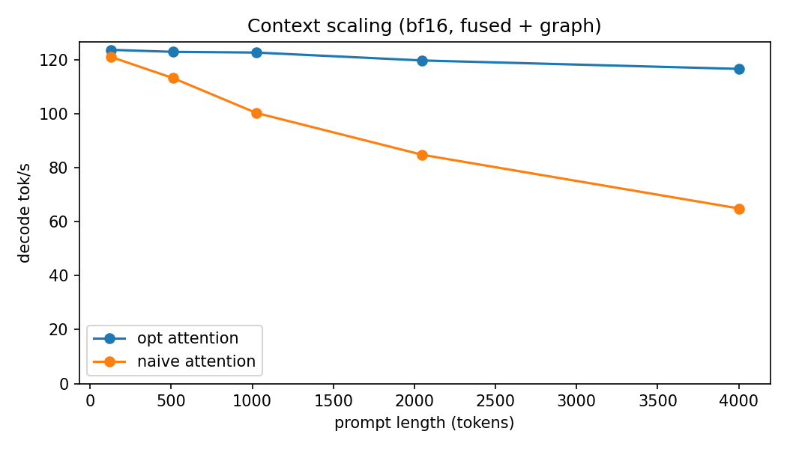
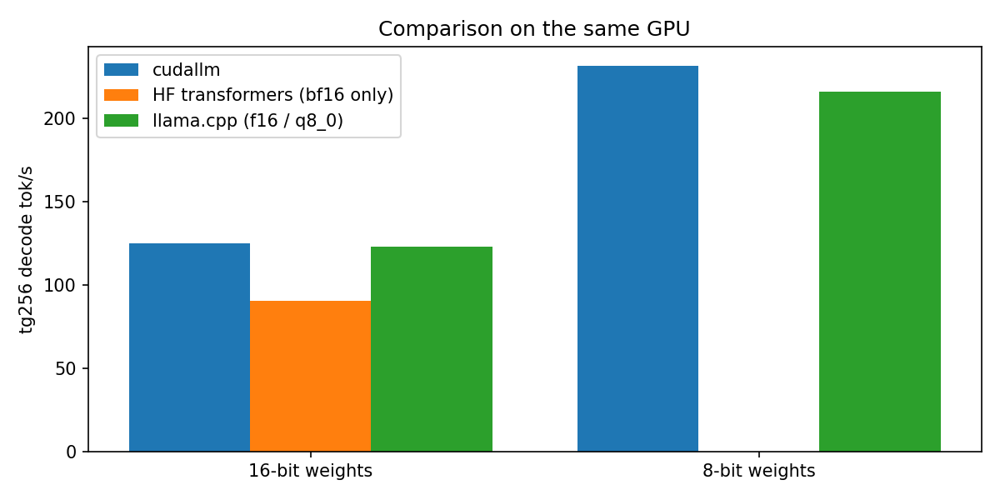

# cudallm — Results

_Generated by `bench/make_report.py` from the files in `results/`. Do not edit by hand._

## 1. Headline

| Metric | Value | Source |
|---|---|---|
| cudallm bf16 decode (A5, prompt 128, gen 256) | 124.80 tok/s | decode/ablation/A5_full.json |
| cudallm bf16 % of measured peak DRAM bandwidth | 90.48 % | decode/ablation/A5_full.json |
| cudallm int4 decode (prompt 128, gen 256) | 383.24 tok/s | decode/quant/Q_int4.json |
| HF transformers bf16 (sdpa, eager, prompt 128) | 90.02 tok/s | compare/hf_bf16.json |
| llama.cpp best of f16/bf16 (tg256, f16) | 123.07 tok/s | compare/llamacpp_f16.json |
| Speedup cudallm A5 vs HF (prompt 128) | 1.39x | — |
| Speedup cudallm bf16 vs llama.cpp best f16/bf16 (tg256) | 1.01x | decode/tg/tg_bf16.json |
| Speedup cudallm int4 vs cudallm bf16 (A5 options) | 3.10x | decode/quant/ |

## 2. Hardware & peak

| Quantity | Value |
|---|---|
| GPU | NVIDIA GeForce RTX 3060 |
| read GB/s (best / median) | 342.11 / 340.83 |
| write GB/s (best / median) | 336.95 / 327.07 |
| copy GB/s, read+write (best / median) | 330.16 / 325.95 |
| cudaMemcpy D2D GB/s, read+write (best) | 331.99 |
| Measured peak (read_gbps_best) | 342.11 GB/s |
| bf16 weight bytes per decode step | 2471764096 |
| Roofline decode rate = peak / weight bytes | 138.41 tok/s |

Source: results/bandwidth.json, results/decode/ablation/A5_full.json.

## 3. Ablation (bf16, prompt 128, gen 256, median of 5)

| Run | Options | tok/s | ms/token | GB/s | % peak | vs A0 | vs previous |
|---|---|---|---|---|---|---|---|
| A0_naive | matvec=naive attn=naive fuse=0 graph=0 rpb=8 | 18.88 | 52.971 | 46.82 | 13.69 | 1.00x | — |
| A1_matvec_opt | matvec=opt attn=naive fuse=0 graph=0 rpb=8 | 115.75 | 8.639 | 287.08 | 83.91 | 6.13x | 6.131x |
| A2_attn_opt | matvec=opt attn=opt fuse=0 graph=0 rpb=8 | 119.83 | 8.345 | 297.21 | 86.87 | 6.35x | 1.035x |
| A3_fused | matvec=opt attn=opt fuse=1 graph=0 rpb=8 | 123.80 | 8.078 | 307.04 | 89.75 | 6.56x | 1.033x |
| A4_graph_nofuse | matvec=opt attn=opt fuse=0 graph=1 rpb=8 | 121.68 | 8.218 | 301.78 | 88.21 | 6.45x | 0.983x |
| A5_full | matvec=opt attn=opt fuse=1 graph=1 rpb=8 | 124.80 | 8.013 | 309.53 | 90.48 | 6.61x | 1.026x |

Source: results/decode/ablation/*.json. 

## 4. Matvec rows-per-block sweep (weighted µs = 16·(qkv+wo+gate_up+down) + lm_head)

| wtype | rpb 1 | rpb 2 | rpb 4 | rpb 8 |
|---|---|---|---|---|
| bf16 | 9020.93 | 8109.31 | 7920.75 | **7709.89** |
| int8 | 5421.06 | 4529.14 | 4239.10 | **4103.42** |
| int4 | 4446.98 | 2944.00 | 2522.62 | **2339.84** |

Winner in bold. Source: results/sweep_matvec.json.

## 5. Quantization (A5 options, prompt 128, gen 256; WikiText-2 PPL, 40 × 512 tokens)

| dtype | weight bytes | tok/s | % peak | PPL (engine) | ΔPPL vs engine bf16 |
|---|---|---|---|---|---|
| bf16 | 2471764096 | 123.59 | 89.60 | 18.4914 | — |
| int8 | 1238037632 | 229.75 | 83.71 | 18.5731 | +0.44 % |
| int4 | 637452416 | 383.24 | 72.35 | 24.4830 | +32.40 % |

HF transformers bf16 PPL on the same protocol: 18.4944 (results/ppl/hf_bf16.json).
Sources: results/decode/quant/*.json, results/ppl/engine_*.json. 

## 6. Context scaling (bf16, fused + graph, gen 32, median of 3)

| prompt length | opt attention tok/s | naive attention tok/s | opt / naive |
|---|---|---|---|
| 128 | 123.65 | 121.05 | 1.02x |
| 512 | 122.90 | 113.19 | 1.09x |
| 1024 | 122.65 | 100.30 | 1.22x |
| 2048 | 119.72 | 84.77 | 1.41x |
| 4000 | 116.59 | 64.90 | 1.80x |

Source: results/decode/context/*.json. 

## 7. Comparison with HF transformers and llama.cpp (same GPU)

| Engine | Weights | Benchmark | tok/s | Source (results/) |
|---|---|---|---|---|
| cudallm | bf16 | tg256 (prompt 1) | 124.68 | decode/tg/tg_bf16.json |
| cudallm | int8 | tg256 (prompt 1) | 231.22 | decode/tg/tg_int8.json |
| cudallm | int4 | tg256 (prompt 1) | 381.18 | decode/tg/tg_int4.json |
| HF transformers | bf16 | tg256 (prompt 1) | 90.22 | compare/hf_bf16_tg.json |
| llama.cpp | f16 | tg256 (prompt 0) | 123.07 | compare/llamacpp_f16.json |
| llama.cpp | bf16 | tg256 (prompt 0) | 122.87 | compare/llamacpp_bf16.json |
| llama.cpp | q8_0 | tg256 (prompt 0) | 215.60 | compare/llamacpp_q8_0.json |
| cudallm | bf16 | prompt 128, gen 256 | 124.80 | decode/ablation/A5_full.json |
| HF transformers | bf16 | prompt 128, gen 256 | 90.02 | compare/hf_bf16.json |

Versions: transformers 4.46.3, torch 2.5.1+cu124; llama.cpp commit fa3645feb (results/compare/llamacpp_commit.txt).

Note: cudallm int8 and llama.cpp q8_0 are not the same format — q8_0 uses one scale per 32-element block, cudallm int8 one scale per output row — so that pair is an approximate comparison.

## 8. Provenance

Distinct git commits across the cudallm/HF result files: d578b10-dirty. llama.cpp: fa3645feb.

| File (results/) | git_commit |
|---|---|
| bandwidth.json | d578b10-dirty |
| sweep_matvec.json | d578b10-dirty |
| compare/hf_bf16.json | d578b10-dirty |
| compare/hf_bf16_tg.json | d578b10-dirty |
| ppl/hf_bf16.json | d578b10-dirty |
| decode/ablation/A0_naive.json | d578b10-dirty |
| decode/ablation/A1_matvec_opt.json | d578b10-dirty |
| decode/ablation/A2_attn_opt.json | d578b10-dirty |
| decode/ablation/A3_fused.json | d578b10-dirty |
| decode/ablation/A4_graph_nofuse.json | d578b10-dirty |
| decode/ablation/A5_full.json | d578b10-dirty |
| decode/quant/Q_bf16.json | d578b10-dirty |
| decode/quant/Q_int8.json | d578b10-dirty |
| decode/quant/Q_int4.json | d578b10-dirty |
| decode/tg/tg_bf16.json | d578b10-dirty |
| decode/tg/tg_int8.json | d578b10-dirty |
| decode/tg/tg_int4.json | d578b10-dirty |
| decode/context/ctx_opt_128.json | d578b10-dirty |
| decode/context/ctx_opt_512.json | d578b10-dirty |
| decode/context/ctx_opt_1024.json | d578b10-dirty |
| decode/context/ctx_opt_2048.json | d578b10-dirty |
| decode/context/ctx_opt_4000.json | d578b10-dirty |
| decode/context/ctx_naiveattn_128.json | d578b10-dirty |
| decode/context/ctx_naiveattn_512.json | d578b10-dirty |
| decode/context/ctx_naiveattn_1024.json | d578b10-dirty |
| decode/context/ctx_naiveattn_2048.json | d578b10-dirty |
| decode/context/ctx_naiveattn_4000.json | d578b10-dirty |
| ppl/engine_bf16.json | d578b10-dirty |
| ppl/engine_int8.json | d578b10-dirty |
| ppl/engine_int4.json | d578b10-dirty |
